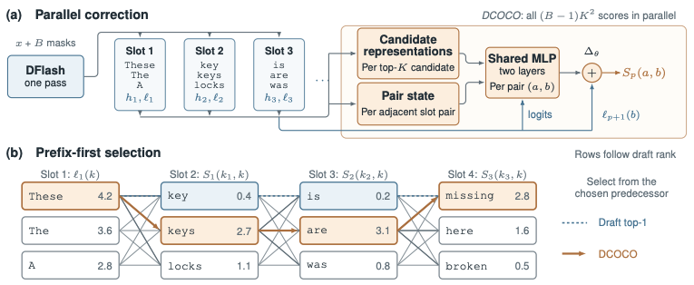

# 🥥 DCOCO: Contextual Correction of Parallel Drafts for Speculative Decoding

**[DCOCO](https://arxiv.org/abs/2610.12570)** (DFlash Contextual Corrector) makes parallel drafters draft like autoregressive ones,
without giving up their speed.

Diffusion-style drafters such as DFlash propose a whole block of tokens in a single pass, but
each position is predicted without seeing which tokens were chosen before it. DCOCO keeps the
top candidates at every position and scores how well neighbouring candidates fit together, all
in one small batched pass. A greedy walk over those scores then picks the draft. Intra-block
dependencies come back, and the cost is a few percent of the drafting cycle.

<p align="center">
  
</p>

**(a)** DFlash drafts every slot in one pass; DCOCO scores all (B−1)K² candidate transitions in parallel from candidate representations and adjacent-slot pair states.
**(b)** A prefix-first walk then picks each slot's best continuation of the chosen predecessor, instead of DFlash's independent top-1.

## Highlights

- **Fastest in every configuration we evaluated:** four verifiers, ten benchmarks, greedy and
  sampled decoding, with and without extended thinking.
- **Up to 6.6× faster than vanilla decoding**, and 3.62× on average on Qwen3-8B (greedy, thinking
  off), against 2.95× for DFlash.
- **Holds up under load:** 6–23% faster than the strongest competing method at 4–32 concurrent
  requests, where the sequential correctors drop below plain DFlash.
- **Ready to serve:** a vLLM image and released drafters, so `vllm serve` is all it takes.

## Results

Average speedup over vanilla decoding across the ten evaluation suites (concurrency 1, one B200
per system):

| Verifier | Thinking | DFlash | Domino | DSpark | **DCOCO** |
|---|---|---|---|---|---|
| Qwen3-4B | off | 2.98× / 2.52× | 3.27× / 2.71× | 2.66× / 2.28× | **3.62× / 2.95×** |
| Qwen3-4B | on | 2.08× / 1.87× | 2.17× / 1.93× | 1.85× / 1.69× | **2.38× / 2.12×** |
| Qwen3-8B | off | 2.95× / 2.45× | 3.16× / 2.53× | 2.88× / 2.37× | **3.62× / 2.87×** |
| Qwen3-8B | on | 1.95× / 1.78× | 1.97× / 1.79× | 1.83× / 1.68× | **2.26× / 2.03×** |
| Qwen3-Coder-30B-A3B | off | 1.89× / 1.67× | 1.94× / 1.67× | 1.84× / 1.62× | **2.31× / 1.98×** |
| Llama-3.1-8B | off | 3.03× / 1.75× | 3.24× / 1.79× | 3.01× / 1.65× | **3.75× / 1.93×** |

Each cell is T=0 / T=1. Per-benchmark throughput and acceptance lengths are in the paper's
appendix.

## Released checkpoints

| Target model | DCOCO drafter | Block size |
|---|---|---|
| `Qwen/Qwen3-8B` | [`TD-Labs/Qwen3-8B-DCOCO`](https://huggingface.co/TD-Labs/Qwen3-8B-DCOCO) | 15 |
| `Qwen/Qwen3-4B` | [`TD-Labs/Qwen3-4B-DCOCO`](https://huggingface.co/TD-Labs/Qwen3-4B-DCOCO) | 15 |

The checkpoints are in vLLM's native format, ready to serve as-is.

## Installation

DCOCO runs in vLLM. The image adds it to the official `vllm/vllm-openai:v0.31.0` release:

```bash
git clone git@github.com:two-delta/DCOCO.git && cd DCOCO
docker build -t dcoco:vllm-v0.31.0 docker/
```

## Quick start

Serve a drafter with its target model; vLLM downloads both from Hugging Face:

```bash
docker run --gpus '"device=0"' --ipc=host -p 8000:8000 \
  -v ~/.cache/huggingface:/root/.cache/huggingface -e HF_TOKEN \
  dcoco:vllm-v0.31.0 Qwen/Qwen3-8B \
  --speculative-config '{"method": "dflash", "model": "TD-Labs/Qwen3-8B-DCOCO", "num_speculative_tokens": 15}'
```

Then query it like any OpenAI-compatible server:

```bash
curl localhost:8000/v1/chat/completions -H 'content-type: application/json' -d '{
  "model": "Qwen/Qwen3-8B",
  "messages": [{"role": "user", "content": "How many positive whole-number divisors does 196 have?"}],
  "chat_template_kwargs": {"enable_thinking": false}
}'
```

## Evaluation

Point the benchmark at a running server:

```bash
python3 scripts/benchmark.py --endpoint http://localhost:8000 --out results/qwen3-8b
```

It runs the paper's ten suites with the paper's settings:

- **Suites:** MATH-500, AIME-25, GSM8K, HumanEval, MBPP, LiveCodeBench, MT-Bench, Arena-Hard-v2,
  Alpaca and SPEED-Bench.
- **Settings:** greedy decoding plus three sampling seeds, max 2048 new tokens, concurrency 1.

It prints throughput and acceptance length per suite. Prompts come from DeepSpec's evaluation
sets in `data/`; by default the benchmark uses the paper's 128 prompts per suite, and `--rows all`
uses every prompt.

## Acknowledgements

DCOCO builds on [DFlash](https://github.com/z-lab/dflash), and we compare against
[Domino](https://github.com/jianuo-huang/Domino) and
[DSpark](https://github.com/deepseek-ai/DeepSpec). Our evaluation prompts come from
[DeepSpec](https://github.com/deepseek-ai/DeepSpec) and NVIDIA's
[SPEED-Bench](https://huggingface.co/datasets/nvidia/SPEED-Bench), and serving is built on
[vLLM](https://github.com/vllm-project/vllm). We thank their authors and maintainers.

```bibtex
@misc{eisenstadt2026contextualcorrectionparalleldrafts,
      title={Contextual Correction of Parallel Drafts for Speculative Decoding}, 
      author={Roy Eisenstadt and Harel Lidar and Tal Gonen and Omer Luxembourg and Itamar Zimerman and Lior Wolf and Eli David and Ilan Naiman},
      year={2026},
      eprint={2610.12570},
      archivePrefix={arXiv},
      primaryClass={cs.CL},
      url={https://arxiv.org/abs/2610.12570}, 
}
```
